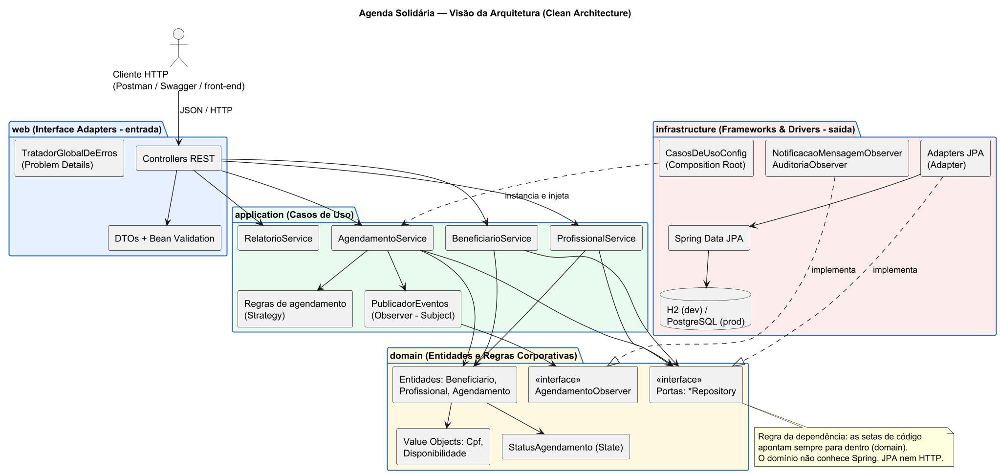
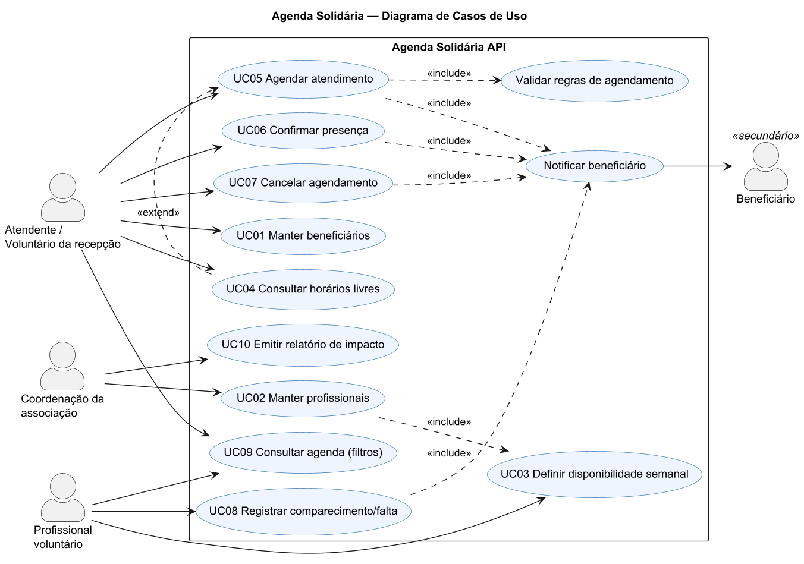
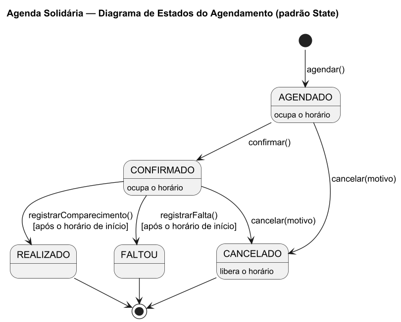
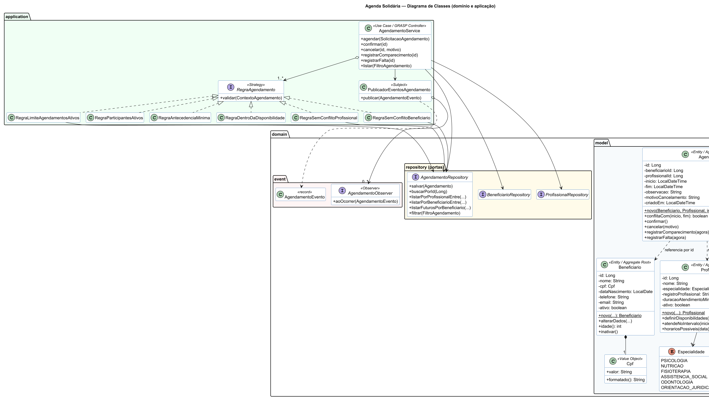
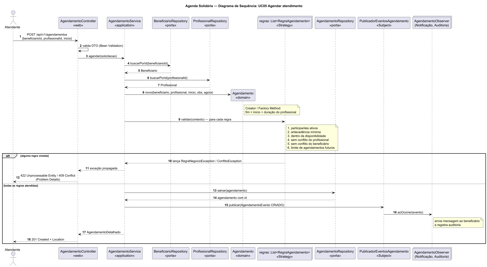

# Agenda Solidária API

> MVP de **API RESTful** para associações comunitárias organizarem os atendimentos gratuitos prestados por
> **profissionais voluntários** (psicologia, nutrição, fisioterapia, assistência social, orientação jurídica...).

Projeto da **Atividade Curricular de Extensão — ACE 8 (2026.2)** da disciplina **Análise e Projeto de Sistemas II**,
curso de Sistemas de Informação do **Centro Universitário Católica de Quixadá — UniCatólica**.

| | |
|---|---|
| **Equipe** | Felipe Freires da Costa (2023010627)<br>Gabriel Samilo Pinto de Oliveira (2023020103)<br>Eric Matheus da Silva Temoteo (2022010143)<br>Gustavo Barros Sampaio (2021020120)<br>Dherick de Sousa Bomfim (2023010636) |
| **Stack** | Java 17 · Spring Boot 3.3 · Spring Data JPA · H2 · Bean Validation · springdoc-openapi · JUnit 5 |
| **Arquitetura** | Clean Architecture + noções de DDD · SOLID · GoF (Strategy, State, Observer, Adapter, Factory Method) · GRASP |

---

## O problema

Em associações de bairro, pastorais e projetos sociais, a agenda dos voluntários costuma ficar em caderno ou
grupo de WhatsApp. Isso gera **horários duplicados**, **vagas ociosas**, **faltas sem registro**, poucas famílias
concentrando as vagas e **dificuldade de prestar contas** a parceiros e doadores.

## O que a API faz

- Cadastro de **beneficiários** (CPF validado, único e devolvido mascarado — LGPD) e de **profissionais
  voluntários** com suas **janelas semanais de disponibilidade** e duração do atendimento.
- **Consulta de horários livres** de um profissional em uma data.
- **Agendamento** com validação automática de 6 regras: participantes ativos, antecedência mínima, dentro da
  disponibilidade, sem conflito para o profissional, sem conflito para o beneficiário e **limite de atendimentos
  futuros por pessoa** (equidade no acesso às vagas).
- **Ciclo de vida** do atendimento: confirmar → registrar comparecimento ou falta, ou cancelar com motivo
  (liberando o horário).
- **Notificação** do beneficiário a cada mudança (simulada em log, pronta para WhatsApp/SMS) e trilha de auditoria.
- **Relatório de impacto social**: atendimentos por status e especialidade, pessoas atendidas e taxa de comparecimento.

## Como executar

Pré-requisito: **JDK 17+** (não é preciso instalar Maven nem banco de dados).

Se o Maven disser `release version 17 not supported`, o `JAVA_HOME` está no JDK 11. No PowerShell:

```powershell
$env:JAVA_HOME = "C:\Program Files\Java\jdk-17.0.12"
```

```bash
# Windows
mvnw.cmd spring-boot:run

# Linux / macOS
./mvnw spring-boot:run
```

| Recurso | URL |
|---|---|
| Tela da associação (demonstração com a comunidade) | http://localhost:8080/ |
| Swagger UI (documentação interativa da API) | http://localhost:8080/swagger-ui/index.html |
| Atalho para o Swagger | http://localhost:8080/docs-api |
| OpenAPI JSON | http://localhost:8080/v3/api-docs |
| Console do H2 | http://localhost:8080/h2-console (JDBC URL `jdbc:h2:mem:agendasolidaria`, usuário `sa`) |

Na tela da associação a recepção marca horários, a coordenação vê o relatório de impacto e o CPF do beneficiário aparece mascarado. O núcleo acadêmico continua sendo a **API REST**.

Ao iniciar, a aplicação carrega **dados fictícios de demonstração** (4 profissionais, 4 beneficiários e
6 agendamentos — incluindo histórico). Para desligar: `agenda.seed.habilitado=false`.

### Testes

```bash
mvnw.cmd test        # testes de domínio, casos de uso (sem Spring) e integração HTTP ponta a ponta
```

## Endpoints

| Método | Rota | Descrição |
|---|---|---|
| `POST` | `/api/v1/beneficiarios` | Cadastra beneficiário |
| `GET` | `/api/v1/beneficiarios?nome=&somenteAtivos=` | Lista beneficiários |
| `GET` | `/api/v1/beneficiarios/{id}` | Busca beneficiário |
| `PUT` | `/api/v1/beneficiarios/{id}` | Atualiza dados de contato |
| `DELETE` | `/api/v1/beneficiarios/{id}` | Inativa (exclusão lógica) |
| `POST` | `/api/v1/profissionais` | Cadastra profissional voluntário |
| `GET` | `/api/v1/profissionais?especialidade=&somenteAtivos=` | Lista profissionais |
| `GET` | `/api/v1/profissionais/{id}` | Busca profissional |
| `PUT` | `/api/v1/profissionais/{id}` | Atualiza profissional |
| `PUT` | `/api/v1/profissionais/{id}/disponibilidades` | Substitui as janelas de disponibilidade |
| `GET` | `/api/v1/profissionais/{id}/horarios-livres?data=AAAA-MM-DD` | Horários livres na data |
| `DELETE` | `/api/v1/profissionais/{id}` | Inativa profissional |
| `POST` | `/api/v1/agendamentos` | Agenda atendimento (valida as regras) |
| `GET` | `/api/v1/agendamentos?profissionalId=&beneficiarioId=&status=&de=&ate=` | Agenda com filtros |
| `GET` | `/api/v1/agendamentos/{id}` | Busca agendamento |
| `PATCH` | `/api/v1/agendamentos/{id}/confirmar` | AGENDADO → CONFIRMADO |
| `PATCH` | `/api/v1/agendamentos/{id}/cancelar` | → CANCELADO (corpo: `{"motivo": "..."}`) |
| `PATCH` | `/api/v1/agendamentos/{id}/comparecimento` | CONFIRMADO → REALIZADO |
| `PATCH` | `/api/v1/agendamentos/{id}/falta` | CONFIRMADO → FALTOU |
| `GET` | `/api/v1/relatorios/atendimentos?de=&ate=` | Indicadores de impacto social |

Erros seguem o padrão **Problem Details (RFC 9457)**: `400` dados inválidos · `404` não encontrado ·
`409` conflito (horário ocupado, CPF duplicado) · `422` regra de negócio violada.

Exemplos prontos: [coleção Postman](docs/api/agenda-solidaria.postman_collection.json) ·
[arquivo .http](docs/api/requisicoes.http).

### Exemplo

```http
POST /api/v1/agendamentos
Content-Type: application/json

{ "beneficiarioId": 3, "profissionalId": 1, "inicio": "2026-11-09T10:30:00",
  "observacao": "Acolhimento inicial - encaminhada pela escola" }
```

```http
HTTP/1.1 201 Created
Location: http://localhost:8080/api/v1/agendamentos/8

{ "id": 8, "status": "AGENDADO", "inicio": "2026-11-09T10:30:00", "fim": "2026-11-09T11:20:00",
  "beneficiario": { "id": 3, "nome": "Francisca Helena Costa", "telefone": "(88) 99903-3003" },
  "profissional": { "id": 1, "nome": "Ana Beatriz Lima", "especialidade": "PSICOLOGIA" }, ... }
```

## Arquitetura



```
domain          → entidades, value objects, State, portas (interfaces)      [Java puro]
application     → casos de uso, regras (Strategy), publicador (Observer)    [Java puro]
web             → controllers REST, DTOs, validação, Problem Details        [Spring MVC]
infrastructure  → adapters JPA, observers de notificação, composition root  [Spring/JPA]
```

Detalhes e justificativas: **[docs/arquitetura-e-padroes.md](docs/arquitetura-e-padroes.md)** ·
Requisitos e regras de negócio: **[docs/requisitos.md](docs/requisitos.md)**

## Diagramas UML

| Casos de uso | Estados do agendamento |
|---|---|
|  |  |

**Classes (domínio e aplicação)**



**Sequência — agendar atendimento**



Fontes PlantUML em [`docs/uml`](docs/uml).

## Evidências

- [Execução de todos os endpoints (requisições e respostas reais)](docs/evidencias/execucao-endpoints.md)
- Capturas: [Swagger](docs/evidencias/01-swagger-endpoints.png) ·
  [POST 201](docs/evidencias/02-swagger-post-agendamento-201.png) ·
  [POST 409](docs/evidencias/03-swagger-post-agendamento-409.png) ·
  [Relatório](docs/evidencias/04-relatorio-impacto.png) ·
  [Testes](docs/evidencias/05-testes-automatizados.png)
- Para regenerar: com a API rodando, `python scripts/gerar_evidencias.py`.

## Próximos passos

Autenticação com perfis (Spring Security + JWT), PostgreSQL em produção, integração real com WhatsApp/SMS
(novo `AgendamentoObserver`), lista de espera e lembrete na véspera.

## Licença

Uso acadêmico e comunitário — [MIT](LICENSE).
