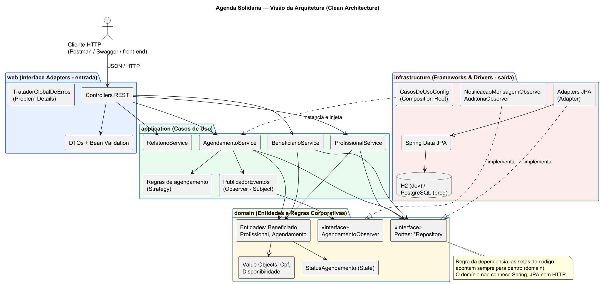

# Arquitetura e Padrões de Projeto — Agenda Solidária

## 1. Visão geral (Clean Architecture)



O código está dividido em quatro camadas concêntricas. **As dependências de código apontam sempre para dentro**:

| Camada | Pacote | Responsabilidade | Conhece Spring/JPA? |
|---|---|---|---|
| Domínio | `domain` | Entidades, Value Objects, regras corporativas, portas (interfaces de repositório e observador) | Não |
| Aplicação | `application` | Casos de uso que orquestram o domínio; regras de agendamento | Não |
| Adaptadores de entrada | `web` | Controllers REST, DTOs, validação de entrada, tradução de erros para HTTP | Sim (Spring MVC) |
| Infraestrutura | `infrastructure` | Persistência JPA (adapters), notificações, configuração / composition root | Sim |

O domínio e a aplicação são **Java puro**. A prova disso está nos testes `AgendamentoServiceTest`, que exercitam
todos os casos de uso com repositórios em memória, sem subir Spring nem banco de dados.

```
src/main/java/br/edu/unicatolica/agendasolidaria
├── domain
│   ├── model        Beneficiario, Profissional, Agendamento, Cpf, Disponibilidade, StatusAgendamento, Especialidade
│   ├── repository   BeneficiarioRepository, ProfissionalRepository, AgendamentoRepository (portas)
│   ├── event        AgendamentoEvento, AgendamentoObserver
│   └── exception    DomainException, RegraNegocioException, ConflitoException, RecursoNaoEncontradoException
├── application
│   ├── beneficiario BeneficiarioService
│   ├── profissional ProfissionalService
│   ├── agendamento  AgendamentoService, PublicadorEventosAgendamento, regra/* (Strategy)
│   └── relatorio    RelatorioService
├── infrastructure
│   ├── persistence  entity/*, jpa/* (Spring Data), adapter/* (implementam as portas)
│   ├── notification NotificacaoMensagemObserver, AuditoriaObserver
│   └── config       CasosDeUsoConfig (composition root), OpenApiConfig, DadosIniciais
└── web
    ├── controller   Beneficiario/Profissional/Agendamento/RelatorioController
    ├── dto          records de request/response
    └── exception    TratadorGlobalDeErros (Problem Details)
```

## 2. Domain-Driven Design (noções aplicadas)

- **Linguagem ubíqua:** classes e métodos usam os termos da associação (beneficiário, profissional voluntário,
  disponibilidade, comparecimento, falta).
- **Agregados:** `Beneficiario`, `Profissional` e `Agendamento` são raízes de agregado; `Agendamento` referencia
  os outros **apenas pelo id**, mantendo os agregados pequenos e independentes.
- **Value Objects imutáveis:** `Cpf` (só existe se for válido) e `Disponibilidade` (janela semanal) são `record`s
  com validação no construtor.
- **Repositórios como portas** definidos no domínio e implementados na infraestrutura.
- **Eventos de domínio:** `AgendamentoEvento` (CRIADO, CONFIRMADO, CANCELADO, REALIZADO, FALTA_REGISTRADA).
- **Entidades ricas:** a regra mora na entidade (`Agendamento.cancelar`, `Profissional.horariosPossiveis`), e não
  em services anêmicos.

## 3. Princípios SOLID

| Princípio | Onde aparece |
|---|---|
| **S** — Responsabilidade Única | Cada `Regra*` valida uma única regra; controllers só traduzem HTTP; adapters só mapeiam/persistem; `TratadorGlobalDeErros` só traduz exceções. |
| **O** — Aberto/Fechado | Nova regra de agendamento = nova classe `RegraAgendamento` registrada em `CasosDeUsoConfig`; novo canal de notificação = novo `AgendamentoObserver`. `AgendamentoService` não muda. |
| **L** — Substituição de Liskov | Qualquer implementação de `AgendamentoRepository` (JPA ou em memória nos testes) é usada pelo caso de uso sem alteração de comportamento. |
| **I** — Segregação de Interfaces | Portas pequenas e específicas por agregado (`BeneficiarioRepository`, `ProfissionalRepository`, `AgendamentoRepository`) e `AgendamentoObserver` com um único método. |
| **D** — Inversão de Dependência | Casos de uso dependem de abstrações (portas) declaradas no domínio; as implementações concretas são injetadas no *composition root* (`CasosDeUsoConfig`). Até o tempo é abstraído (`java.time.Clock`). |

## 4. Padrões GoF

| Padrão | Categoria | Classes | Por que neste domínio |
|---|---|---|---|
| **Strategy** | Comportamental | `RegraAgendamento` + 6 implementações | As regras de marcação variam por associação (antecedência, limite por família). Cada uma é uma estratégia plugável e testável isoladamente. |
| **State** | Comportamental | `StatusAgendamento` (enum com comportamento) | O agendamento tem ciclo de vida bem definido; cada estado sabe quais transições aceita, eliminando `if/else` e tornando impossível, por exemplo, registrar falta em um atendimento cancelado. |
| **Observer** | Comportamental | `AgendamentoObserver`, `PublicadorEventosAgendamento`, `NotificacaoMensagemObserver`, `AuditoriaObserver` | Avisar o beneficiário (WhatsApp/SMS) e auditar são efeitos colaterais; o caso de uso publica o evento sem conhecer quem reage. A falha de um observador não desfaz o agendamento. |
| **Adapter** | Estrutural | `*RepositoryAdapter` | Adaptam a API do Spring Data JPA (entidades JPA) para as portas do domínio (objetos de domínio puros). |
| **Factory Method** | Criacional | `Agendamento.novo(...)`, `Beneficiario.novo(...)`, `*.reconstituir(...)` | Centralizam a criação válida dos objetos e distinguem "criar novo" de "reconstituir do banco". |

## 5. Padrões GRASP

| Padrão | Aplicação |
|---|---|
| **Information Expert** | `Disponibilidade.abrange()`, `Profissional.horariosPossiveis()`, `Agendamento.conflitaCom()` — quem tem a informação executa o cálculo. |
| **Creator** | `Agendamento.novo(beneficiario, profissional, ...)` usa os dados do profissional (duração) para criar o agendamento. |
| **Controller** | Controllers REST recebem os eventos do sistema e delegam; `AgendamentoService` é o controlador do caso de uso. |
| **Low Coupling** | Agregados referenciados por id; camadas internas sem dependência de framework. |
| **High Cohesion** | Pacotes por responsabilidade; classes pequenas e focadas. |
| **Polymorphism** | Regras, observadores e estados usam polimorfismo no lugar de condicionais. |
| **Pure Fabrication** | `PublicadorEventosAgendamento`, `RelatorioService`, adapters — classes que não existem no mundo real, criadas para manter coesão. |
| **Indirection** | Portas de repositório e o publicador de eventos isolam o caso de uso dos detalhes técnicos. |
| **Protected Variations** | A variação "onde os dados ficam" e "como o beneficiário é notificado" está protegida por interfaces estáveis. |

## 6. Design da API REST

- Recursos no plural e versionados: `/api/v1/beneficiarios`, `/api/v1/profissionais`, `/api/v1/agendamentos`,
  `/api/v1/relatorios`.
- `POST` → `201 Created` + cabeçalho `Location`; `DELETE` → `204 No Content` (inativação lógica).
- Transições de estado como sub-recursos de ação com `PATCH` (`/confirmar`, `/cancelar`, `/comparecimento`,
  `/falta`), deixando explícita a intenção.
- Erros padronizados (RFC 9457):

| Situação | Status |
|---|---|
| Campos inválidos (Bean Validation), JSON malformado | 400 |
| Recurso inexistente | 404 |
| Conflito de horário, CPF duplicado | 409 |
| Regra de negócio violada (fora da disponibilidade, antecedência, transição inválida, CPF inválido) | 422 |

## 7. Diagramas UML

- [Casos de uso](img/casos-de-uso.png) — fonte: [`uml/01-casos-de-uso.puml`](uml/01-casos-de-uso.puml)
- [Classes](img/classes-dominio.png) — fonte: [`uml/02-classes-dominio.puml`](uml/02-classes-dominio.puml)
- [Sequência — agendar](img/sequencia-agendar.png) — fonte: [`uml/03-sequencia-agendar.puml`](uml/03-sequencia-agendar.puml)
- [Arquitetura](img/arquitetura.png) — fonte: [`uml/04-arquitetura.puml`](uml/04-arquitetura.puml)
- [Estados do agendamento](img/estados-agendamento.png) — fonte: [`uml/05-estados-agendamento.puml`](uml/05-estados-agendamento.puml)

Para regenerar as imagens: `java -jar plantuml.jar -charset UTF-8 -tpng -o ../img docs/uml/*.puml`.
